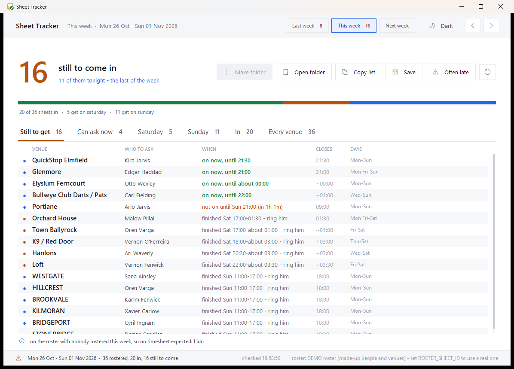
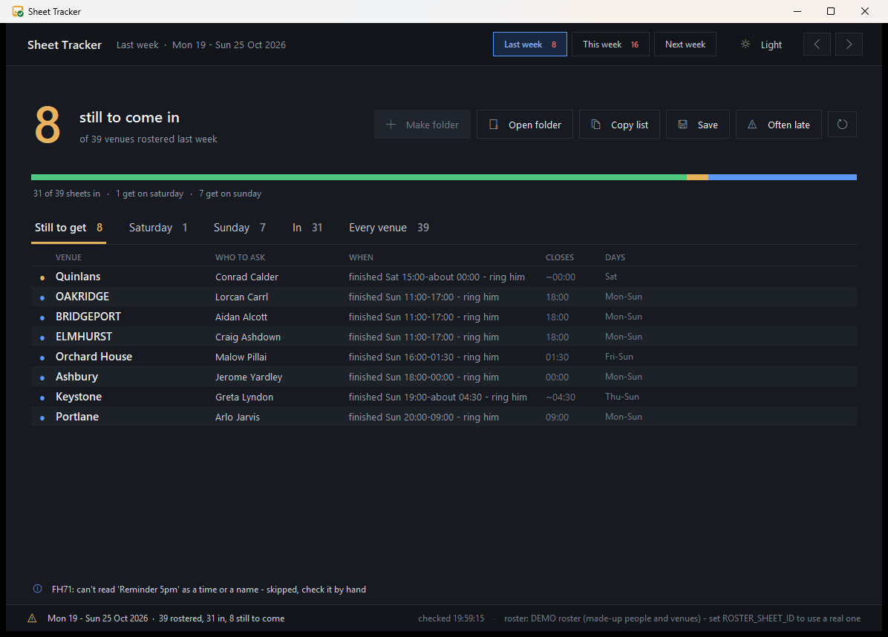

# Sheet Tracker

**Which venues' timesheets are still missing this week, who to ask for each one, and when to ring them.**

A Windows desktop tool for a security company's control room. Every week each guarded venue (bars, clubs,
shops, a bingo hall) sends in a photo of its signed timesheet. Sheet Tracker reads the staff roster, finds
the week's folder of timesheet photos, matches every photo to a venue, and lists what is still to come in,
with the guard who has it and the moment their shift ends.



> All screenshots and the bundled roster use **made-up people and venues**. The demo roster keeps the
> layout of a real roster export, but every name, venue and note in it is invented and the comments are removed.

## What it does

- **Reads the roster** (a Google Sheet, downloaded as a read-only `.xlsx` export; it never writes to it) and
  works out every venue with somebody rostered between Monday and Sunday.
- **Finds the week's folder** (`Timesheets DD.MM.YY`, named for the Sunday) on the Desktop or in the yearly
  archive, and accepts older spellings (`Timesheet 09.02.25`, `timesheets w.e. 20.04.25`, ...).
- **Matches photos to venues** from messy file names: `K9 (1).png`, `Perch - 3.jpg`, `voltmart westgate.png`,
  typos, page numbers and WhatsApp names included. Names it can't match can be assigned by hand once
  and are remembered.
- **Says who to ask and when.** For each missing sheet it names the guard on that venue's last shift and
  whether they are on now, finished ("ring him"), or not on until later, with a live countdown.
- **Knows closing times.** 30 of 41 venues have an end time on the roster. For the rest
  ("20:00-close"), `ocrscan.ps1` reads thousands of past timesheets with Windows' built-in OCR, and
  `ocrclose.py` votes on the most likely "time out" for each venue.
- **Chase list.** Mark a venue as asked, copy or save the list to send, see which venues are *often late*.
- Light and dark themes, keyboard shortcuts (F5 reload, PgUp/PgDn change week), and an icon designed to be
  told apart from its sister tool at 16×16.



## Quick start (demo)

Needs **Python 3.11+ on Windows** (developed on 3.13). No third-party packages: it uses the standard library and tkinter only.

```bash
git clone https://github.com/Assembler-Fourier/sheet-tracker.git
cd sheet-tracker
python tool/app.pyw
```

With no roster configured it starts in **demo mode**. `demo/make_demo.py` copies the invented roster with
its dates moved forward to the current week, and fills `demo/Desktop/` with ten weeks of placeholder
timesheet images, some still missing, so the window has a realistic week to show.

Command line:

```bash
python tool/timesheets.py             # the week being collected now
python tool/timesheets.py last        # the week that has just finished
python tool/timesheets.py 04/10       # the week containing that date
python tool/timesheets.py --late 12   # which venues go missing most often over 12 weeks
```

## Using it with a real roster

Share the roster Google Sheet as *anyone with the link can view*, then either set an environment variable

```bash
setx ROSTER_SHEET_ID "your-google-sheet-id"
```

or create `tool/config.json` (ignored by git):

```json
{ "roster_id": "your-google-sheet-id", "desktop": "C:/Users/you/Desktop" }
```

`Sheet Tracker.bat` opens the window without a console. Put a shortcut to it on the Desktop.

## How the roster is read

The roster is one wide sheet: for each week, a label column of venues (black cells) and seven day columns.
Under each day are pairs of rows, a shift time (`20:00-close`, `21:00-03-00`) above a guard's name. Green
means confirmed, yellow provisional, struck-through cancelled.

`xl.py` is a ~100-line read-only `.xlsx` reader (zip + XML, no openpyxl). `timesheets.py` turns cells into
venues, shifts and people. It handles notes typed into the venue column, labels typed into day columns,
duplicated or missing date headers and venues closed on Sundays.

## Tests

Five checks, all standard library. Run all five after any change:

```bash
python tool/selftest.py --window   # week maths, file-name matching, pinned demo weeks, the window off-screen
python tool/faketest.py            # awkward cases on a roster built by fakeroster.py
python tool/flowtest.py            # drives every button of the window off-screen (tkinter swallows errors - this catches them)
python tool/sweep.py 2026          # every week of a year through the check
python tool/audit.py               # invariants on every week: in + missing = rostered, each file counted once, ...
```

`audit.py` also "winds the clock" through every venue of every week in 20-minute steps and insists the
answer only ever moves *not yet → on now → finished*.

## Layout

```
Sheet Tracker.bat      opens the window
tool/
  app.pyw              the window (tkinter)
  timesheets.py        roster reading, venue matching, who/when to ask - and the CLI
  xl.py                minimal read-only xlsx reader
  ocrscan.ps1          Windows.Media.Ocr over every timesheet photo -> ocr/words.jsonl
  ocrclose.py          words.jsonl -> ocr/closing.json (closing time per venue)
  makeicon.py          draws app.ico, pure stdlib
  selftest.py faketest.py flowtest.py sweep.py audit.py fakeroster.py closing.py
demo/
  roster-template.xlsx invented roster in the real layout
  make_demo.py         dates moved to this week + placeholder timesheet photos
docs/screenshots/
```

Sister project: [check-call-log](https://github.com/Assembler-Fourier/check-call-log), which reads the same roster.

## Licence

MIT. See [LICENSE](LICENSE).
